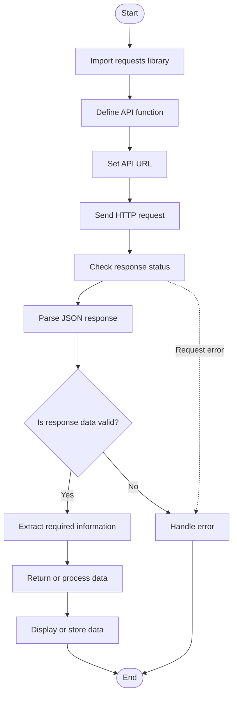

# Python API Handling 

## steps 

1. **Import Library** — `import requests`
2. **Define Function** — Create a function to handle the API.
3. **Set API URL** — Store the endpoint in a variable.
4. **Send Request** — Use `requests.get()` or another HTTP method.
5. **Check Response** — Verify the status using `response.raise_for_status()`.
6. **Parse JSON** — Convert the response using `response.json()`.
7. **Validate Data** — Check success and required keys.
8. **Extract Data** — Access the required values from dictionaries or lists.
9. **Return Data** — Return the extracted values if needed.
10. **Call Function** — Use the function in `main()`.
11. **Handle Errors** — Use `try-except` for request and processing errors.
12. **Display or Store** — Print or save the result.

## Flow

**Request → Check → Parse → Validate → Extract → Return → Display → Handle Errors**

# Python API Handling — General Flow
# Python API Handling — Flowchart

